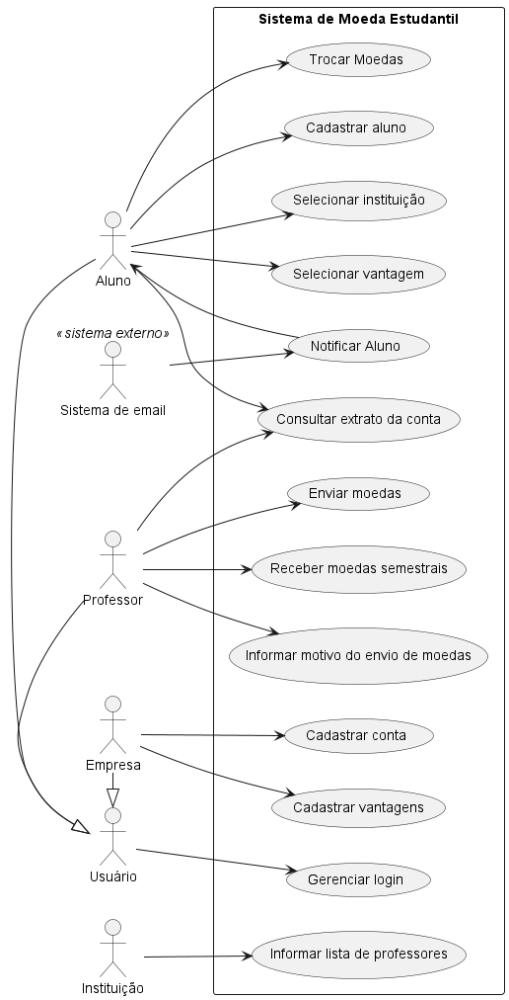
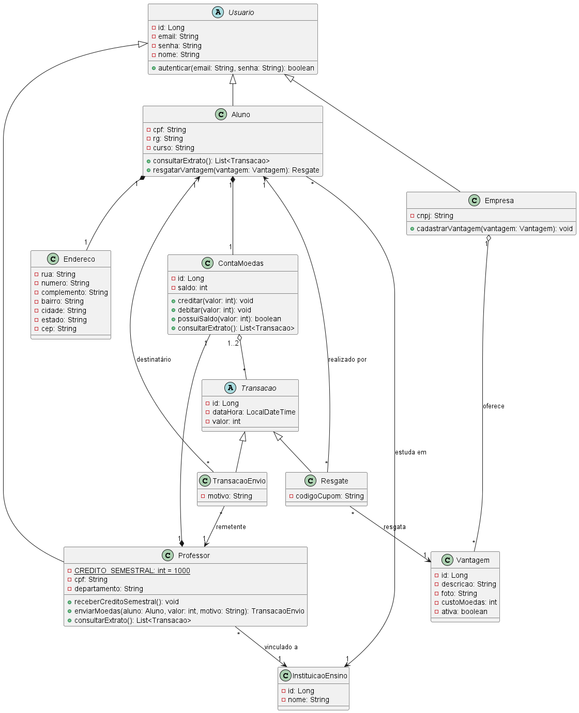
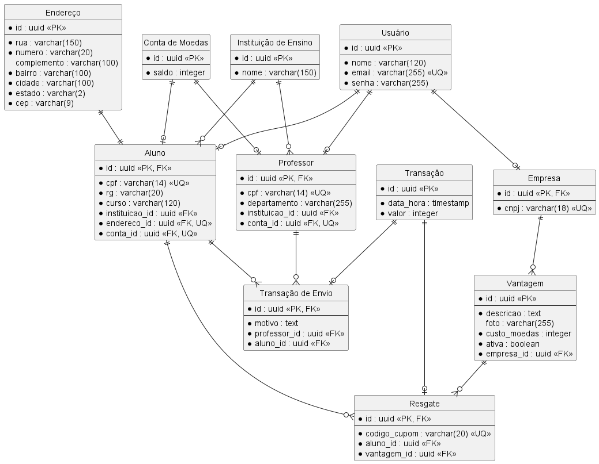

# 🪙 Sistema de Moeda Estudantil

> [!NOTE]
> Sistema de mérito em que professores reconhecem seus alunos com moedas virtuais, que podem ser trocadas por vantagens oferecidas por empresas parceiras.


---

## 📚 Índice
- [Sobre o Projeto](#-sobre-o-projeto)
- [Descrição do Sistema](#-descrição-do-sistema)
- [Status do Projeto](#-status-do-projeto)
- [Funcionalidades Implementadas](#-funcionalidades-implementadas)
- [Tecnologias Utilizadas](#-tecnologias-utilizadas)
- [Arquitetura](#-arquitetura)
  - [Diagramas](#diagramas)
- [API](#-api)
- [Instalação e Execução](#-instalação-e-execução)
  - [Pré-requisitos](#pré-requisitos)
  - [Variáveis de Ambiente](#-variáveis-de-ambiente)
  - [Banco de Dados (Docker Compose)](#-banco-de-dados-docker-compose)
  - [Back-end](#-back-end)
  - [Front-end](#-front-end)
- [Estrutura de Pastas](#-estrutura-de-pastas)
- [Testes](#-testes)
- [Documentação do Projeto](#-documentação-do-projeto)
- [Autores](#-autores)
- [Contribuição](#-contribuição)
- [Agradecimentos](#-agradecimentos)

---

## 📝 Sobre o Projeto

O **Sistema de Moeda Estudantil** foi desenvolvido no **Laboratório de Desenvolvimento de Software** do curso de Engenharia de Software da **PUC Minas**. A ideia é incentivar o bom desempenho e a participação dos alunos: os professores distribuem moedas como forma de reconhecimento, e os alunos trocam essas moedas por vantagens oferecidas por empresas parceiras, como descontos em restaurantes da universidade, desconto de mensalidade ou compra de materiais.

O sistema envolve quatro participantes:

- **Instituições de ensino:** já vêm cadastradas no sistema e enviam a lista dos seus professores ao firmar a parceria.
- **Professores:** já vêm cadastrados e recebem moedas a cada semestre para distribuir aos alunos.
- **Alunos:** fazem o próprio cadastro, recebem moedas e as trocam por vantagens.
- **Empresas parceiras:** fazem o próprio cadastro e oferecem vantagens com um custo em moedas.

---

## 📋 Descrição do Sistema

Requisitos definidos para o sistema:

1. **Cadastro de alunos:** o aluno informa nome, e-mail, CPF, RG, endereço, instituição de ensino e curso. A instituição é escolhida entre as que já estão cadastradas no sistema.
2. **Professores pré-cadastrados:** a instituição envia a lista de professores no momento da parceria. Cada professor está vinculado a uma instituição, e o sistema guarda o nome, o CPF e o departamento dele.
3. **Distribuição semestral:** a cada semestre, cada professor recebe **1.000 moedas**. O saldo é **acumulável**: as moedas que não forem distribuídas em um semestre se somam às 1.000 do semestre seguinte.
4. **Envio de moedas:** o professor precisa ter saldo suficiente. Ele escolhe o aluno, define a quantidade e escreve o **motivo** do reconhecimento, que é obrigatório.
5. **Notificação:** o aluno recebe um **e-mail** sempre que ganha moedas.
6. **Extrato:** professores e alunos podem ver o saldo atual e o histórico de transações. O professor vê os envios que fez, e o aluno vê as moedas que recebeu e as trocas que realizou.
7. **Cadastro de empresas parceiras:** a empresa se cadastra e registra as vantagens que quer oferecer, com o **custo em moedas**, uma **descrição** e uma **foto** de cada uma.
8. **Resgate de vantagens:** o aluno escolhe uma vantagem e o valor dela é descontado do seu saldo. O sistema gera um **código** e o envia em um e-mail de cupom para o aluno, que usa o cupom na troca presencial, e em um e-mail equivalente para a empresa parceira, que confere a troca com o mesmo código.
9. **Autenticação:** alunos, professores e empresas parceiras acessam o sistema com **login e senha**, e é preciso estar autenticado para usar as funcionalidades.

---

## 🚧 Status do Projeto

O projeto está **em desenvolvimento**. A tabela mostra a situação de cada requisito:

| Requisito | Situação | Observações |
| :--- | :---: | :--- |
| Cadastro, edição, listagem e exclusão de alunos | ✅ Implementado | Back-end e front-end |
| Instituições de ensino pré-cadastradas | ✅ Implementado | Carga inicial com PUC Minas, UFMG e CEFET-MG |
| Cadastro, edição, listagem e exclusão de empresas parceiras | ✅ Implementado | Back-end e front-end |
| Armazenamento seguro de senhas | ✅ Implementado | Hash com `bcryptjs`; a senha nunca é retornada pela API |
| Cadastro de vantagens (descrição, foto e custo) | 🟡 Parcial | Entidade `Vantagem` modelada no banco; ainda sem rotas e telas |
| Professores pré-cadastrados (nome, CPF, departamento) | ⏳ Pendente | Modelado nos diagramas |
| Distribuição semestral de 1.000 moedas com saldo acumulável | ⏳ Pendente | |
| Envio de moedas com motivo obrigatório | ⏳ Pendente | |
| Notificação do aluno por e-mail | ⏳ Pendente | |
| Extrato de professores e alunos | ⏳ Pendente | |
| Resgate de vantagens com cupom e código por e-mail | ⏳ Pendente | |
| Login e autenticação | ⏳ Pendente | As senhas já são cadastradas, mas ainda não existe login e as rotas não exigem autenticação |

---

## ✨ Funcionalidades Implementadas

- 🎓 **Gestão de alunos:** cadastro com nome, e-mail, senha, CPF, RG, curso, instituição de ensino e endereço completo, além de edição, listagem e exclusão.
- 🏢 **Gestão de empresas parceiras:** cadastro com nome, e-mail, senha e CNPJ, além de edição, listagem e exclusão.
- 🏫 **Instituições pré-cadastradas:** na primeira vez que o back-end sobe, ele cadastra as instituições participantes, que ficam disponíveis para o aluno escolher no cadastro.
- ✅ **Validações nos formulários:** dígitos verificadores de CPF e CNPJ, formato de e-mail, campos obrigatórios e máscaras de CPF, CNPJ e CEP.
- 📮 **Preenchimento automático do endereço:** a partir do CEP, usando a API pública do [ViaCEP](https://viacep.com.br/).
- 🔒 **Senhas protegidas:** são armazenadas com hash (`bcryptjs`) e removidas das respostas da API.
- 🚫 **Tratamento de erros:** a API responde com mensagens claras para campos obrigatórios, registros não encontrados (404) e e-mail, CPF ou CNPJ duplicados (409).
- 📊 **Visão geral:** painel com os totais de alunos, empresas e instituições, os cadastros mais recentes e as etapas do programa de mérito.
- 🧭 **Interface web:** menu lateral, rotas na URL via hash (`#/alunos`, `#/empresas`, `#/alunos/novo`), que mantêm a página ao recarregar, busca, paginação, modais de confirmação, avisos de sucesso e erro, e indicação de quando o servidor está offline.

---

## 🛠 Tecnologias Utilizadas

### 💻 Front-end

* **Biblioteca:** React 19
* **Linguagem:** TypeScript
* **Build Tool:** Vite 8
* **Estilização:** CSS puro (`src/index.css`)
* **Roteamento:** hook próprio (`useRota`), sem bibliotecas externas
* **Lint:** oxlint
* **Integração externa:** ViaCEP, para buscar o endereço pelo CEP

### 🖥️ Back-end

* **Runtime:** Node.js
* **Linguagem:** TypeScript
* **Framework:** Express 5
* **ORM:** TypeORM, com `synchronize` ativo, que cria e atualiza o schema na inicialização
* **Banco de Dados:** PostgreSQL 16
* **Segurança:** `bcryptjs`, para o hash das senhas
* **Outros:** `cors`, `dotenv` e `ts-node-dev`, que reinicia o servidor automaticamente no desenvolvimento

### ⚙️ Infraestrutura

* **Containerização:** Docker Compose, usado para subir o PostgreSQL

---

## 🏗 Arquitetura

O sistema é dividido em dois projetos independentes que se comunicam por HTTP/JSON:

- **Front-end (SPA em React):** carrega alunos, empresas e instituições uma única vez e mantém tudo em memória, para não repetir requisições a cada troca de página. Cada operação de cadastro, edição ou exclusão chama a API e atualiza o estado local com a resposta.
- **Back-end (API REST em Express):** organizado em camadas, cada uma com uma responsabilidade:

```
Rotas  →  Controllers  →  Services  →  Repositories  →  TypeORM  →  PostgreSQL
```

| Camada | Responsabilidade |
| :--- | :--- |
| `routes/` | Define os endpoints e liga cada um ao seu controller |
| `controllers/` | Recebem a requisição HTTP e devolvem a resposta com o status adequado |
| `services/` | Regras de negócio: validação de campos obrigatórios, hash de senha, remoção da senha das respostas |
| `repositories/` | Acesso aos dados pelo TypeORM |
| `entities/` | Mapeamento das tabelas (`Usuario`, `Aluno`, `Empresa`, `Endereco`, `InstituicaoEnsino`, `Vantagem`) |
| `errors/` | `AppError`, tratado por um middleware global de erros |

A classe abstrata `Usuario` concentra os campos comuns de quem acessa o sistema (`nome`, `email`, `senha`), e `Aluno` e `Empresa` herdam dela.

### Diagramas

Os diagramas ficam em [`docs/diagramas`](./docs/diagramas). Os arquivos-fonte `.puml` são do PlantUML.

| Diagrama de Casos de Uso | Diagrama de Classes |
| :---: | :---: |
|  |  |
| **Diagrama Entidade-Relacionamento** | **Diagrama de Componentes** |
|  |  |

---

## 🔌 API

Por padrão, a API responde em `http://localhost:3000`. Todas as rotas trabalham com JSON.

| Método | Rota | Descrição |
| :--- | :--- | :--- |
| `GET` | `/` | Verifica se a API está no ar |
| `GET` | `/instituicoes` | Lista as instituições de ensino |
| `GET` | `/alunos` | Lista os alunos |
| `GET` | `/alunos/:id` | Busca um aluno |
| `POST` | `/alunos` | Cadastra um aluno |
| `PUT` | `/alunos/:id` | Atualiza um aluno (só os campos enviados) |
| `DELETE` | `/alunos/:id` | Remove um aluno |
| `GET` | `/empresas` | Lista as empresas parceiras |
| `GET` | `/empresas/:id` | Busca uma empresa |
| `POST` | `/empresas` | Cadastra uma empresa |
| `PUT` | `/empresas/:id` | Atualiza uma empresa (só os campos enviados) |
| `DELETE` | `/empresas/:id` | Remove uma empresa |

**Exemplo: cadastro de aluno**

```bash
curl -X POST http://localhost:3000/alunos \
  -H 'Content-Type: application/json' \
  -d '{
    "nome": "Maria Souza",
    "email": "maria@email.com",
    "senha": "senha123",
    "cpf": "123.456.789-09",
    "rg": "MG-12.345.678",
    "curso": "Engenharia de Software",
    "instituicaoId": "<id retornado por GET /instituicoes>",
    "endereco": {
      "rua": "Rua Dom José Gaspar",
      "numero": "500",
      "bairro": "Coração Eucarístico",
      "cidade": "Belo Horizonte",
      "estado": "MG",
      "cep": "30535-901"
    }
  }'
```

**Respostas de erro** (sempre no formato `{ "erro": "mensagem" }`):

| Status | Quando acontece |
| :---: | :--- |
| `400` | Falta um campo obrigatório |
| `404` | O aluno, a empresa ou a instituição não foi encontrado |
| `409` | Já existe um cadastro com o mesmo e-mail, CPF ou CNPJ |
| `500` | Erro interno do servidor |

---

## 🔧 Instalação e Execução

### Pré-requisitos

* **Node.js:** 20.19+ ou 22.12+ (versões exigidas pelo Vite 8)
* **npm**
* **Docker** e **Docker Compose**, para rodar o PostgreSQL. Se preferir, use um PostgreSQL instalado localmente.

### 🔑 Variáveis de Ambiente

#### Back-end (`backend/.env`)

Crie um arquivo `.env` dentro da pasta `backend`. Esse arquivo não é versionado. Os valores abaixo batem com o `docker-compose.yml`:

```env
DB_HOST=localhost
DB_PORT=5432
DB_USER=postgres
DB_PASSWORD=postgres
DB_NAME=moeda_estudantil
PORT=3000
```

| Variável | Descrição | Padrão |
| :--- | :--- | :--- |
| `DB_HOST` | Host do PostgreSQL | — |
| `DB_PORT` | Porta do PostgreSQL | — |
| `DB_USER` | Usuário do banco | — |
| `DB_PASSWORD` | Senha do banco | — |
| `DB_NAME` | Nome do banco | — |
| `PORT` | Porta da API | `3000` |

#### Front-end (`frontend/.env`), opcional

| Variável | Descrição | Padrão |
| :--- | :--- | :--- |
| `VITE_API_URL` | URL base da API | `http://localhost:3000` |

### 💾 Banco de Dados (Docker Compose)

Na raiz do projeto, rode:

```bash
docker compose up -d
```

Esse comando sobe o container `moeda-postgres` (PostgreSQL 16) na porta `5432`, com o banco `moeda_estudantil`. Os dados ficam guardados no volume `moeda_dados`. As tabelas são criadas automaticamente pelo TypeORM quando o back-end inicia.

Para parar o banco:

```bash
docker compose down
```

### 🖥️ Back-end

```bash
cd backend
npm install
npm run dev
```

Quando o servidor sobe, aparecem as mensagens `Banco conectado` e `Servidor rodando em http://localhost:3000`. Na primeira execução, as instituições iniciais também são cadastradas.

| Script | Descrição |
| :--- | :--- |
| `npm run dev` | Modo de desenvolvimento, com reinício automático |
| `npm run build` | Compila o TypeScript para a pasta `dist/` |
| `npm start` | Executa a versão compilada |

### 🎨 Front-end

Em outro terminal:

```bash
cd frontend
npm install
npm run dev
```

A aplicação fica disponível em **http://localhost:5173**.

| Script | Descrição |
| :--- | :--- |
| `npm run dev` | Servidor de desenvolvimento do Vite |
| `npm run build` | Verifica os tipos e gera o build de produção em `dist/` |
| `npm run preview` | Serve o build de produção localmente |
| `npm run lint` | Executa o oxlint |

---

## 📂 Estrutura de Pastas

```
.
├── docker-compose.yml            # 🐳 PostgreSQL para desenvolvimento
├── README.md
│
├── backend/                      # 📁 API REST (Express + TypeORM)
│   ├── package.json
│   ├── tsconfig.json
│   └── src/
│       ├── index.ts              # 🚀 Inicialização do servidor e middleware de erros
│       ├── data-source.ts        # 🔧 Conexão com o PostgreSQL (TypeORM)
│       ├── routes/               # 🛣️ Definição dos endpoints
│       ├── controllers/          # 🎮 Camada HTTP
│       ├── services/             # ⚙️ Regras de negócio
│       ├── repositories/         # 🗄️ Acesso a dados
│       ├── entities/             # 🧬 Entidades (Usuario, Aluno, Empresa, Endereco, InstituicaoEnsino, Vantagem)
│       └── errors/               # 💥 AppError
│
├── frontend/                     # 📁 Aplicação web (React + Vite)
│   ├── index.html
│   ├── public/                   # 🖼️ Favicon e ícones
│   └── src/
│       ├── App.tsx               # 🧠 Estado global e chamadas à API
│       ├── api.ts                # 🔌 Cliente HTTP
│       ├── rotas.ts              # 🧭 Mapeamento das páginas
│       ├── types.ts              # 🏷️ Tipos compartilhados
│       ├── index.css             # 🎨 Estilos globais
│       ├── pages/                # 📄 Visão geral, Alunos e Empresas
│       ├── components/           # 🧱 Formulários, modal, campos, avisos, paginação, ícones
│       ├── hooks/                # 🎣 useRota
│       └── utils/                # 🛠️ Máscaras, validação de CPF/CNPJ e busca de CEP
│
└── docs/
    ├── historia-de-usuario.md    # 📖 Histórias de usuário
    ├── diagramas/                # 📐 Casos de uso, classes, DER e componentes (.puml e .png)
    └── contribuicoes/            # 🤝 Registro semanal de contribuições de cada integrante
```

---

## 🧪 Testes

O projeto ainda não tem testes automatizados.

---

## 📖 Documentação do Projeto

* [Histórias de usuário](./docs/historia-de-usuario.md)
* [Diagramas](./docs/diagramas)
* Contribuições: [Bruno Henrique](./docs/contribuicoes/bruno-henrique/contribuicoes.md) · [João Vitor Porto](./docs/contribuicoes/joao-vitor-porto/contribuicoes.md)

Referências técnicas:

* [React](https://react.dev/reference/react)
* [Vite](https://vite.dev/config/)
* [Express](https://expressjs.com/)
* [TypeORM](https://typeorm.io/)
* [PostgreSQL](https://www.postgresql.org/docs/)
* [ViaCEP](https://viacep.com.br/)
* [Conventional Commits](https://www.conventionalcommits.org/pt-br/v1.0.0/)

---

## 👥 Autores

| 👤 Nome | :octocat: GitHub |
| :--- | :--- |
| Bruno Henrique | [@brunokilo](https://github.com/brunokilo) |
| João Vitor Porto Lorencini | [@jvplorencini](https://github.com/jvplorencini) |

---

## 🤝 Contribuição

1. Crie uma branch para a sua feature (`git checkout -b feature/minha-feature`).
2. Faça commits seguindo o padrão [Conventional Commits](https://www.conventionalcommits.org/pt-br/v1.0.0/), por exemplo `feat: envio de moedas pelo professor`.
3. Envie a branch (`git push origin feature/minha-feature`).
4. Abra um **Pull Request** para a `main`.
5. Registre a sua contribuição da semana em `docs/contribuicoes/<seu-nome>/contribuicoes.md`.

---

## 🙏 Agradecimentos

* [**Engenharia de Software PUC Minas**](https://www.instagram.com/engsoftwarepucminas/), pelo apoio institucional e pela estrutura acadêmica.
* [**Prof. Dr. João Paulo Aramuni**](https://github.com/joaopauloaramuni), pela orientação no Laboratório de Desenvolvimento de Software e pelo template deste README.
